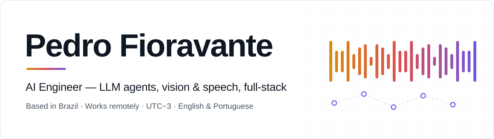
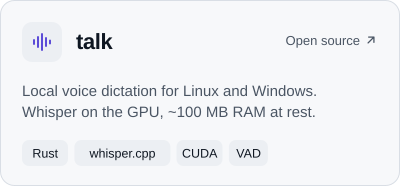
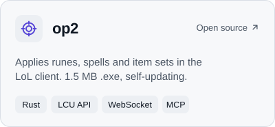
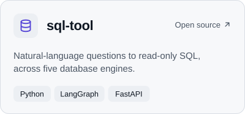
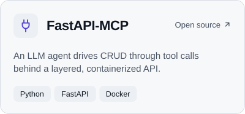
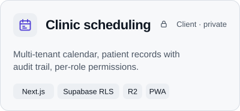
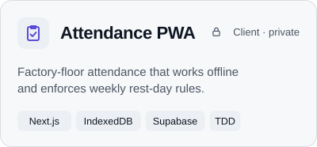
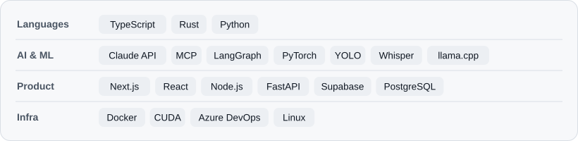

<picture>
  <source media="(prefers-color-scheme: dark)" srcset="assets/dark/header.svg">
  
</picture>

  <a href="https://fioravante.dev.br"><picture><source media="(prefers-color-scheme: dark)" srcset="assets/dark/website.svg"></picture></a>
  <a href="https://www.linkedin.com/in/fioravante-dev/"><picture><source media="(prefers-color-scheme: dark)" srcset="assets/dark/linkedin.svg"></picture></a>
  <a href="mailto:pedrocfioravante95+gitpage@gmail.com"><picture><source media="(prefers-color-scheme: dark)" srcset="assets/dark/email.svg"></picture></a>

I build software that does real work: **LLM agents** that act on codebases and dev workflows, **vision and speech** systems from dataset to deployed API, and the **full-stack products** around them. I ship fast with AI in the loop, and I care about what happens after the demo: tests, deploys, costs and the boring edge cases.

## What I work on

<table>
  <tr>
    <td width="50%" valign="top"> <b>LLM agents in production</b> Tool-calling agents that read code, triage work, write fixes and open pull requests, with humans reviewing the result. Claude API, MCP, LangGraph.</td>
    <td width="50%" valign="top"> <b>Computer vision</b> Training CNNs from scratch and fine-tuning them for detection, segmentation and classification. Building and annotating datasets, benchmarking models, serving them behind APIs, and integrating cloud vision services.</td>
  </tr>
  <tr>
    <td valign="top"> <b>Speech</b> Real-time and batch transcription with Whisper, on local GPUs with whisper.cpp and through hosted inference. Voice activity detection and speaker diarization.</td>
    <td valign="top"> <b>Local and private AI</b> Models on llama.cpp for data that can't leave the machine, PII anonymization, and GPU memory budgeting.</td>
  </tr>
  <tr>
    <td valign="top"> <b>Systems</b> Rust services and orchestration, Docker, CI/CD on Azure DevOps, and desktop tooling for Linux and Windows.</td>
    <td valign="top"> <b>Full-stack products</b> Next.js, React, Supabase and Postgres with row-level security, offline-first PWAs, test-driven development.</td>
  </tr>
</table>

## Open source

My portfolio, [fioravante.dev.br](https://fioravante.dev.br), is one Rust binary served from an Android phone on my desk, with the phone's live CPU, temperature and battery on the page. Try `curl -s fioravante.dev.br` in a terminal.

<a href="https://github.com/fioravante-dev/talk"><picture><source media="(prefers-color-scheme: dark)" srcset="assets/dark/card-talk.svg"></picture></a>
<a href="https://github.com/fioravante-dev/op2"><picture><source media="(prefers-color-scheme: dark)" srcset="assets/dark/card-op2.svg"></picture></a>
<a href="https://github.com/fioravante-dev/sql-tool"><picture><source media="(prefers-color-scheme: dark)" srcset="assets/dark/card-sql-tool.svg"></picture></a>
<a href="https://github.com/fioravante-dev/FastAPI-MCP"><picture><source media="(prefers-color-scheme: dark)" srcset="assets/dark/card-fastapi-mcp.svg"></picture></a>

## Built for clients

Private code, production systems. Happy to walk through either one.

<picture><source media="(prefers-color-scheme: dark)" srcset="assets/dark/card-clinic.svg"></picture>
<picture><source media="(prefers-color-scheme: dark)" srcset="assets/dark/card-attendance.svg"></picture>

## Stack

<picture>
  <source media="(prefers-color-scheme: dark)" srcset="assets/dark/stack.svg">
  
</picture>
