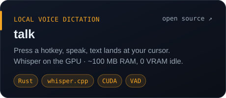
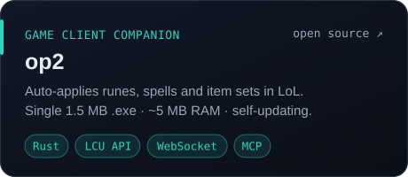
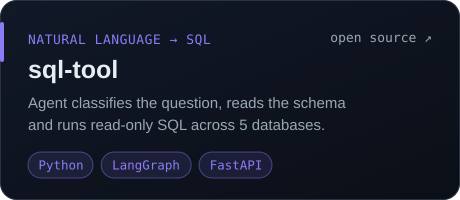
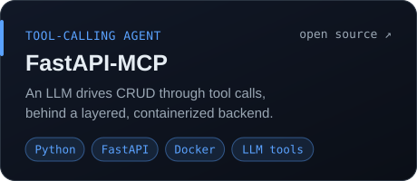
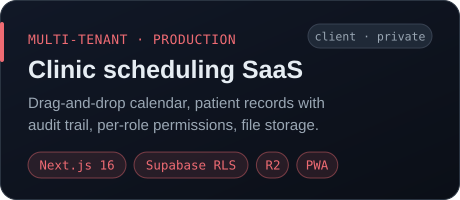
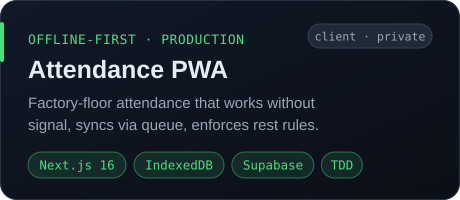

  

  
  
  

I build software that does real work: **LLM agents** that act on codebases and dev workflows, **vision and speech** pipelines from training to serving, and the **full-stack products** around them. I ship fast with AI in the loop, and I care about what happens after the demo: tests, deploys, costs and the boring edge cases.

## What I work on

| | |
|---|---|
| 🤖 **LLM agents in production** Tool-calling agents that read code, triage work, write fixes and open pull requests, with humans reviewing the result. Claude API, MCP, LangGraph. | 👁️ **Computer vision** Training and fine-tuning CNNs for detection, segmentation and classification. Dataset curation, model benchmarking, and vision models served behind APIs. PyTorch, YOLO. |
| 🎙️ **Speech** Real-time and batch transcription with Whisper (whisper.cpp on GPU and hosted inference), voice activity detection and speaker diarization. | 🔒 **Local & private AI** Running models with llama.cpp for data that can't leave the machine, PII anonymization, GPU memory budgeting. |
| ⚙️ **Systems** Rust services and orchestration, Docker, CI/CD on Azure DevOps, Linux and Windows desktop tooling. | 🧱 **Full-stack products** Next.js, React, Supabase/Postgres with row-level security, offline-first PWAs, test-driven development. |

## Open source

  
  
  
  

## Built for clients

Private code · production systems · details shared on request

  
  

## Stack

  

`Claude API` `MCP` `LangGraph` `LangChain` `Whisper` `whisper.cpp` `llama.cpp` `YOLO` `CUDA` `FastAPI` `Azure DevOps`
